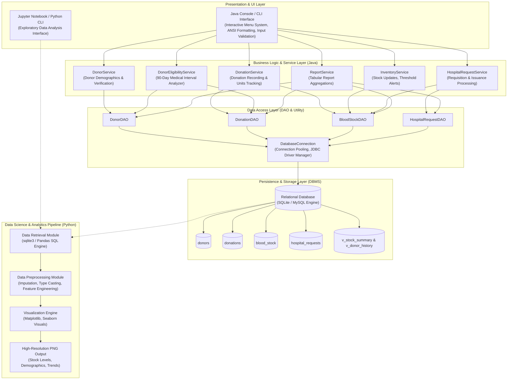
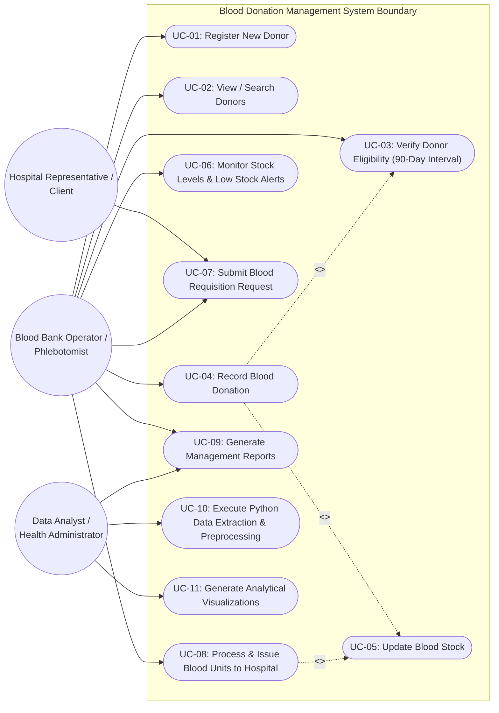
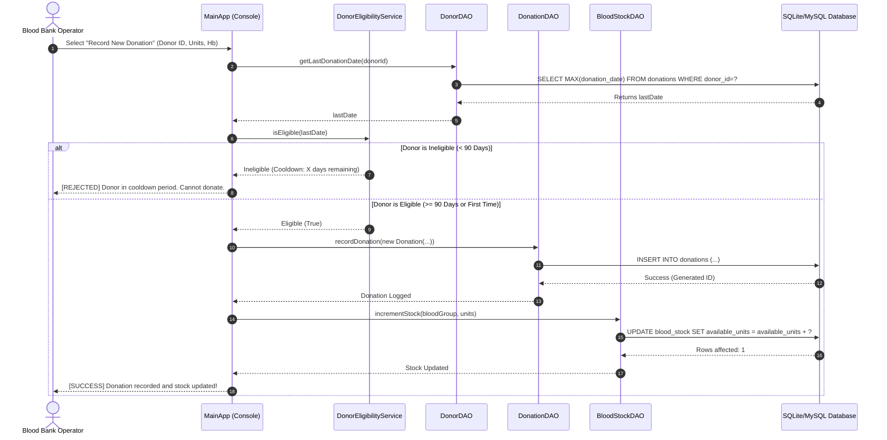
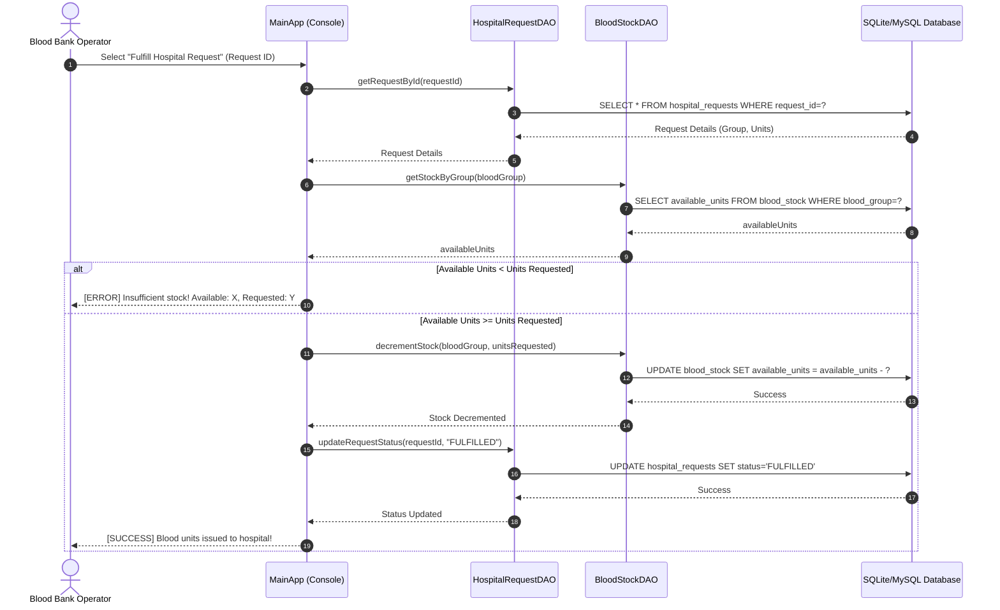

# Architecture and Design Diagrams
## Blood Donation Management and Donor Availability Analysis System
**Academic Year:** 2026 - 2027 (ODD)  
**Course Code & Name:** 25ITT33 - Software Engineering / 25ITT32 - Java Programming  
**Student Name:** Karan Raajaa V  
**Register Number:** 732925ITR045  
**Class / Section:** 25IT3A (Roll No. 45)  
**Scenario:** Scenario 15 - Blood Donation Management and Donor Availability Analysis System  

---

## 1. Overall System Architecture

The system is designed following a **Multi-Tier Layered Architecture Pattern** that enforces strict separation of concerns, high cohesion, and loose coupling between presentation, application logic, data access, and analytical visualization components.

### 1.1 Architectural Layers



---

## 2. Use Case Diagram

The Use Case Diagram defines the interactions between the system's human and external actors (**Blood Bank Operator / Phlebotomist**, **Hospital Representative**, **Data Analyst / Administrator**) and the core functional workflows.

### 2.1 Use Case Specifications



### 2.2 Use Case Descriptions

| Use Case ID | Use Case Name | Primary Actor | Preconditions | Postconditions |
|---|---|---|---|---|
| **UC-01** | Register New Donor | Operator | Donor is not already registered with same phone/email. | Donor record added to `donors` table. |
| **UC-03** | Verify Donor Eligibility | Operator | Donor exists in database. | Eligibility status returned (Eligible vs Cooldown days remaining). |
| **UC-04** | Record Blood Donation | Operator | Donor verified eligible (UC-03). | Donation logged in `donations`, blood stock incremented in `blood_stock`. |
| **UC-05** | Update Blood Stock | System / Operator | Valid unit increment or decrement. | `blood_stock` units atomically updated, timestamp refreshed. |
| **UC-08** | Process Blood Issuance | Operator | Hospital request pending, sufficient stock available. | Stock decremented, request marked `FULFILLED`, issuance logged. |
| **UC-11** | Generate Analytical Charts | Data Analyst | Database contains donation and stock history. | 5+ high-resolution PNG charts generated in `visualizations/`. |

---

## 3. Class Diagram

> [!NOTE]
> **Interactive & Vector Class Diagrams Available**:
> - Interactive Web Viewer: [class_diagram.html](file:///E:/Assingment_1/diagrams/class_diagram.html)
> - Scalable Vector Graphic (SVG): [class_diagram.svg](file:///E:/Assingment_1/diagrams/class_diagram.svg)

### 3.1 Inheritance / Generalization Hierarchy (Person & Specialized Roles)
Matching standard UML 3-compartment class notation with generalization inheritance arrows pointing from specialized roles up to the base `Person` superclass:

```
                               +-------------------------------------+
                               |               Person                |
                               +-------------------------------------+
                               | +id: int                            |
                               | +name: String                       |
                               | +contactNumber: String              |
                               | +email: String                      |
                               | +city: String                       |
                               +-------------------------------------+
                               | +getContactDetails(): String        |
                               | +validateDetails(): boolean         |
                               +-------------------------------------+
                                                 ^
                                                 | (Generalization <|--)
                     +---------------------------+---------------------------+
                     |                                                       |
   +------------------------------------+                 +------------------------------------+
   |               Donor                |                 |       HospitalRepresentative       |
   +------------------------------------+                 +------------------------------------+
   | +age: int                          |                 | +hospitalName: String              |
   | +gender: String                    |                 | +department: String                |
   | +bloodGroup: String                |                 | +urgencyLevel: String              |
   | +registrationDate: LocalDate       |                 +------------------------------------+
   +------------------------------------+                 | +submitRequisition(): void         |
   | +isAgeEligible(): boolean          |                 | +trackFulfillment(): void          |
   | +getDaysUntilEligible(): int       |                 | +receiveStock(): void              |
   | +makeDonation(): Donation          |                 +------------------------------------+
   +------------------------------------+
                     | 1
                     |
                     | makes (Directed Association -->)
                     v 0..*
   +------------------------------------+                 +------------------------------------+
   |              Donation              |   increments    |             BloodStock             |
   +------------------------------------+   ---------->   +------------------------------------+
   | -donationId: int                   | 0..*          1 | -bloodGroup: String                |
   | -donorId: int                      |                 | -availableUnits: int               |
   | -bloodGroup: String                |                 | -minimumThreshold: int = 5         |
   | -donationDate: LocalDate           |                 | -lastUpdated: LocalDateTime        |
   | -unitsDonated: int = 1             |                 +------------------------------------+
   | -hemoglobinLevel: double           |                 | +isLowStock(thresh: int): boolean  |
   | -phlebotomistName: String          |                 | +incrementStock(units: int): bool  |
   | -remarks: String                   |                 | +decrementStock(units: int): bool  |
   +------------------------------------+                 | +getSurplusDeficit(): int          |
   | +isHemoglobinValid(): boolean      |                 +------------------------------------+
   | +calculateCooldownDays(): int      |                                   ^
   +------------------------------------+                                   | 1
                                                                            | requisitions
                                                                            | 0..*
                                                          +------------------------------------+
                                                          |          HospitalRequest           |
                                                          +------------------------------------+
                                                          | -requestId: int                    |
                                                          | -hospitalName: String              |
                                                          | -bloodGroup: String                |
                                                          | -unitsRequested: int               |
                                                          | -urgencyLevel: String              |
                                                          | -status: String = "PENDING"        |
                                                          +------------------------------------+
                                                          | +canBeFulfilled(stock: int): bool  |
                                                          | +markFulfilled(auth: String): void |
                                                          +------------------------------------+
```

### 3.2 Detailed Multi-Tier Class Diagram Specification
classDiagram
    direction TB

    %% Model Classes
    class Donor {
        -int donorId
        -String name
        -int age
        -String gender
        -String contactNumber
        -String email
        -String bloodGroup
        -LocalDate registrationDate
        +getDonorId() int
        +getName() String
        +getAge() int
        +getGender() String
        +getContactNumber() String
        +getEmail() String
        +getBloodGroup() String
        +getRegistrationDate() LocalDate
        +toString() String
    }

    class Donation {
        -int donationId
        -int donorId
        -String bloodGroup
        -LocalDate donationDate
        -int unitsDonated
        -double hemoglobinLevel
        -String remarks
        +getDonationId() int
        +getDonorId() int
        +getBloodGroup() String
        +getDonationDate() LocalDate
        +getUnitsDonated() int
        +getHemoglobinLevel() double
        +getRemarks() String
        +toString() String
    }

    class BloodStock {
        -String bloodGroup
        -int availableUnits
        -LocalDateTime lastUpdated
        +getBloodGroup() String
        +getAvailableUnits() int
        +getLastUpdated() LocalDateTime
        +isLowStock(threshold: int) boolean
        +toString() String
    }

    class HospitalRequest {
        -int requestId
        -String hospitalName
        -String bloodGroup
        -int unitsRequested
        -LocalDate requestDate
        -String urgencyLevel
        -String status
        -LocalDate fulfillmentDate
        +getRequestId() int
        +getHospitalName() String
        +getBloodGroup() String
        +getUnitsRequested() int
        +getUrgencyLevel() String
        +getStatus() String
        +setStatus(status: String) void
        +toString() String
    }

    %% DAO Layer
    class DonorDAO {
        +addDonor(donor: Donor) boolean
        +getDonorById(id: int) Donor
        +getAllDonors() List~Donor~
        +getDonorsByBloodGroup(group: String) List~Donor~
        +getLastDonationDate(donorId: int) LocalDate
    }

    class DonationDAO {
        +recordDonation(donation: Donation) boolean
        +getAllDonations() List~Donation~
        +getDonationsByDonorId(donorId: int) List~Donation~
        +getTotalUnitsByBloodGroup() Map~String, Integer~
    }

    class BloodStockDAO {
        +getAllStock() List~BloodStock~
        +getStockByGroup(group: String) BloodStock
        +incrementStock(group: String, units: int) boolean
        +decrementStock(group: String, units: int) boolean
    }

    class HospitalRequestDAO {
        +createRequest(request: HospitalRequest) boolean
        +getAllRequests() List~HospitalRequest~
        +getPendingRequests() List~HospitalRequest~
        +updateRequestStatus(id: int, status: String) boolean
    }

    %% Service Layer
    class DonorEligibilityService {
        -int ELIGIBILITY_INTERVAL_DAYS
        +isEligible(lastDonationDate: LocalDate) boolean
        +getDaysUntilEligible(lastDonationDate: LocalDate) long
        +getEligibleDonors(bloodGroup: String) List~Donor~
    }

    class InventoryService {
        -int LOW_STOCK_THRESHOLD
        +receiveDonationUnits(group: String, units: int) boolean
        +issueUnits(group: String, units: int) boolean
        +checkLowStockAlerts() List~BloodStock~
    }

    class DatabaseConnection {
        -String DB_URL
        -Connection connection
        +getConnection() Connection
        +initializeDatabase() void
        +closeConnection() void
    }

    class MainApp {
        +main(args: String[]) void
        +displayMainMenu() void
        +handleDonorManagement() void
        +handleDonations() void
        +handleHospitalRequests() void
        +handleStockReports() void
        +handleEligibilityAudit() void
    }

    %% Relationships
    Donor "1" <-- "0..*" Donation : makes
    Donation "1" --> "1" BloodStock : increments
    HospitalRequest "1" --> "1" BloodStock : decrements
    
    MainApp ..> DonorDAO : uses
    MainApp ..> DonationDAO : uses
    MainApp ..> BloodStockDAO : uses
    MainApp ..> HospitalRequestDAO : uses
    MainApp ..> DonorEligibilityService : uses
    MainApp ..> InventoryService : uses

    DonorDAO ..> DatabaseConnection : retrieves connection
    DonationDAO ..> DatabaseConnection : retrieves connection
    BloodStockDAO ..> DatabaseConnection : retrieves connection
    HospitalRequestDAO ..> DatabaseConnection : retrieves connection
```

---

## 4. Sequence Diagrams

### 4.1 Sequence Diagram: Record Blood Donation and Update Inventory
The following sequence diagram details the workflow when an operator attempts to record a donation, illustrating the eligibility check, atomic database insertion, and inventory increment.



### 4.2 Sequence Diagram: Hospital Request Fulfillment
This sequence diagram shows the verification of available stock and issuance to a healthcare facility.



---
*Prepared and verified for academic submission by Karan Raajaa V (Reg. No: 732925ITR045).*

