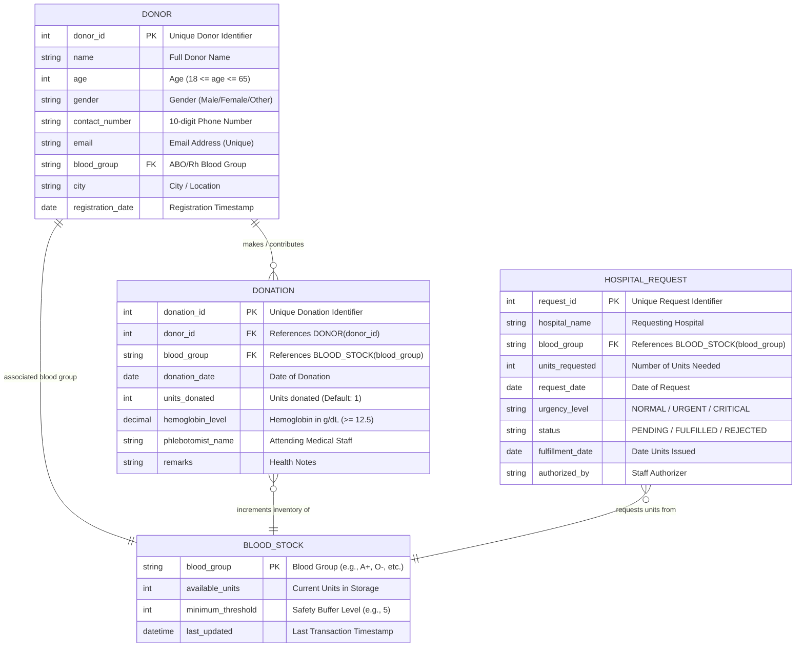

# Database Design and Normalization Document
## Blood Donation Management and Donor Availability Analysis System
**Academic Year:** 2026 - 2027 (ODD)  
**Course Code & Name:** 25ITT31 - Database Management Systems  
**Student Name:** Karan Raajaa V  
**Register Number:** 732925ITR045  
**Class / Section:** 25IT3A (Roll No. 45)  
**Scenario:** Scenario 15 - Blood Donation Management and Donor Availability Analysis System  

---

## 1. Entity-Relationship (ER) Design

The database schema is designed to represent real-world blood banking entities, their inherent properties (attributes), and the associative mappings (relationships and cardinalities) governing blood collection, inventory management, and hospital requisitions.

### 1.1 ER Diagram

### 1.2 Entity Specifications & Cardinalities

1. **`DONOR` to `DONATION` (One-to-Many - $1:N$):**
   - A single registered donor may make zero, one, or multiple donations over time ($0..N$).
   - Each donation must be made by exactly one registered donor ($1..1$).
2. **`DONATION` to `BLOOD_STOCK` (Many-to-One - $N:1$):**
   - Multiple donations correspond to a specific blood group inventory.
   - Each donation increments the stock for exactly one specific blood group.
3. **`HOSPITAL_REQUEST` to `BLOOD_STOCK` (Many-to-One - $N:1$):**
   - Multiple hospital requests can be filed for a given blood group.
   - Each request references exactly one blood group stock.

---

## 2. Relational Model

The relational model translates conceptual entities into relational tables with defined schemas, domains, primary keys ($\text{PK}$), foreign keys ($\text{FK}$), and integrity constraints.

### 2.1 Relational Schema Definitions

1. **`blood_stock`**
   - $\text{Schema: } \mathbf{blood\_stock}(\underline{\text{blood\_group}}, \text{available\_units}, \text{minimum\_threshold}, \text{last\_updated})$
   - $\text{Primary Key: } \{\text{blood\_group}\}$
   - $\text{Domain Constraints: } \text{blood\_group} \in \{'A+', 'A-', 'B+', 'B-', 'AB+', 'AB-', 'O+', 'O-'\}$; $\text{available\_units} \ge 0$.

2. **`donors`**
   - $\text{Schema: } \mathbf{donors}(\underline{\text{donor\_id}}, \text{name}, \text{age}, \text{gender}, \text{contact\_number}, \text{email}, \text{blood\_group}, \text{city}, \text{registration\_date})$
   - $\text{Primary Key: } \{\text{donor\_id}\}$
   - $\text{Foreign Key: } [\text{blood\_group}] \text{ REFERENCES } \mathbf{blood\_stock}(\text{blood\_group})$
   - $\text{Integrity Constraints: } \text{age} \text{ BETWEEN } 18 \text{ AND } 65$; $\text{contact\_number} \text{ matches regular expression } '^[0-9]{10}\$'$; $\text{email}$ is $\text{UNIQUE}$.

3. **`donations`**
   - $\text{Schema: } \mathbf{donations}(\underline{\text{donation\_id}}, \text{donor\_id}, \text{blood\_group}, \text{donation\_date}, \text{units\_donated}, \text{hemoglobin\_level}, \text{phlebotomist\_name}, \text{remarks})$
   - $\text{Primary Key: } \{\text{donation\_id}\}$
   - $\text{Foreign Keys: }$
     - $[\text{donor\_id}] \text{ REFERENCES } \mathbf{donors}(\text{donor\_id}) \text{ ON DELETE CASCADE}$
     - $[\text{blood\_group}] \text{ REFERENCES } \mathbf{blood\_stock}(\text{blood\_group})$
   - $\text{Integrity Constraints: } \text{units\_donated} \ge 1$; $\text{hemoglobin\_level} \ge 12.0$.

4. **`hospital_requests`**
   - $\text{Schema: } \mathbf{hospital\_requests}(\underline{\text{request\_id}}, \text{hospital\_name}, \text{blood\_group}, \text{units\_requested}, \text{request\_date}, \text{urgency\_level}, \text{status}, \text{fulfillment\_date}, \text{authorized\_by})$
   - $\text{Primary Key: } \{\text{request\_id}\}$
   - $\text{Foreign Key: } [\text{blood\_group}] \text{ REFERENCES } \mathbf{blood\_stock}(\text{blood\_group})$
   - $\text{Integrity Constraints: } \text{units\_requested} > 0$; $\text{urgency\_level} \in \{'NORMAL', 'URGENT', 'CRITICAL'\}$; $\text{status} \in \{'PENDING', 'FULFILLED', 'REJECTED'\}$.

---

## 3. Database Normalization Analysis

Normalization is the systematic process of organizing data to reduce redundancy and eliminate update, insertion, and deletion anomalies. The design is evaluated from **Unnormalized Form (UNF)** through **Boyce-Codd Normal Form (BCNF)**.

### 3.1 Initial Unnormalized Form (UNF)
In a legacy spreadsheet or paper log, a single unnormalized table stores all donation and requisition transactions with repeating groups and mixed entities:

$$\text{UNF\_RECORD} = \{ \text{DonorID}, \text{DonorName}, \text{Age}, \text{Phone}, \text{BloodGroup}, \text{StockUnits}, \text{DonationHistory}(\text{DonationID}, \text{DonationDate}, \text{Units}), \text{HospitalReqHistory}(\dots) \}$$

**Anomalies Present in UNF:**
- **Insertion Anomaly:** Cannot insert a new blood group stock entry without registering a dummy donor.
- **Deletion Anomaly:** Deleting a donor's record permanently deletes historical blood donation statistics.
- **Update Anomaly:** If a donor's phone number or a blood group's stock level changes, multiple redundant rows must be updated.

---

### 3.2 First Normal Form (1NF)
**Definition:** A relation $R$ is in 1NF if and only if all domain values are atomic (indivisible) and there are no repeating groups or multivalued attributes.

**Transformation to 1NF:**
1. Decompose nested repeating groups (`DonationHistory`, `HospitalReqHistory`) into individual flat tuples.
2. Ensure every column contains atomic scalar values (e.g., splitting composite names/addresses into discrete fields).
3. Designate candidate keys for each identified tuple stream.

Flat 1NF Relation:
$$\text{R\_FLAT}(\underline{\text{DonorID}, \text{DonationID}}, \text{Name}, \text{Age}, \text{Phone}, \text{BloodGroup}, \text{StockUnits}, \text{DonationDate}, \text{UnitsDonated}, \text{HospitalName}, \dots)$$

---

### 3.3 Second Normal Form (2NF)
**Definition:** A relation $R$ is in 2NF if it is in 1NF and no non-prime attribute is partially dependent on any candidate key (elimination of partial functional dependencies).

**Functional Dependency Analysis on Composite Key $\{\text{DonorID}, \text{DonationID}\}$:**
- $\text{FD}_1: \text{DonorID} \to \text{Name}, \text{Age}, \text{Phone}, \text{BloodGroup}$ *(Partial Dependency: dependent only on part of the composite key $\text{DonorID}$)*
- $\text{FD}_2: \text{DonationID} \to \text{DonationDate}, \text{UnitsDonated}, \text{HemoglobinLevel}, \text{DonorID}$
- $\text{FD}_3: \text{BloodGroup} \to \text{StockUnits}$ *(Partial Dependency)*

**Decomposition to 2NF:**
We decompose into separate relations according to their independent determinants:
1. $\mathbf{donors}(\underline{\text{donor\_id}}, \text{name}, \text{age}, \text{gender}, \text{contact\_number}, \text{email}, \text{blood\_group}, \text{city}, \text{registration\_date})$
2. $\mathbf{donations}(\underline{\text{donation\_id}}, \text{donor\_id}, \text{blood\_group}, \text{donation\_date}, \text{units\_donated}, \text{hemoglobin\_level})$
3. $\mathbf{blood\_stock}(\underline{\text{blood\_group}}, \text{available\_units}, \text{minimum\_threshold}, \text{last\_updated})$
4. $\mathbf{hospital\_requests}(\underline{\text{request\_id}}, \text{hospital\_name}, \text{blood\_group}, \text{units\_requested}, \text{request\_date}, \text{urgency\_level}, \text{status})$

All non-prime attributes now depend upon the full candidate key of their respective relations. Hence, all relations satisfy **2NF**.

---

### 3.4 Third Normal Form (3NF)
**Definition:** A relation $R$ is in 3NF if it is in 2NF and no non-prime attribute is transitively dependent on the primary key ($X \to Y$ and $Y \to Z$ where $Z$ is non-prime and $Y$ is not a candidate key).

**Evaluation for Transitive Dependencies:**
- In $\mathbf{donors}$: Primary key is $\text{donor\_id}$.
  - $\text{donor\_id} \to \text{email}$ (Unique key)
  - $\text{donor\_id} \to \text{contact\_number}$
  - $\text{donor\_id} \to \text{blood\_group}$
  - Does $\text{blood\_group} \to \text{available\_units}$ exist inside $\mathbf{donors}$? **No.** `available_units` has been separated into $\mathbf{blood\_stock}$.
- In $\mathbf{donations}$: Primary key is $\text{donation\_id}$.
  - $\text{donation\_id} \to \text{donor\_id}$
  - $\text{donation\_id} \to \text{donation\_date}$
  - No transitive dependencies between non-prime attributes exist.
- In $\mathbf{hospital\_requests}$: Primary key is $\text{request\_id}$.
  - All attributes ($\text{hospital\_name}, \text{units\_requested}, \text{status}$) directly depend strictly on $\text{request\_id}$.

Hence, no transitive dependencies exist on non-prime attributes. The schema satisfies **3NF**.

---

### 3.5 Boyce-Codd Normal Form (BCNF)
**Definition:** A relation $R$ is in BCNF if and only if for every functional dependency $X \to Y$, the determinant $X$ is a **Superkey**.

**BCNF Verification for all relations:**
1. **$\mathbf{donors}$:**
   - Determinants are $\{\text{donor\_id}\}$ and $\{\text{email}\}$. Both are candidate keys / superkeys. Satisfies BCNF.
2. **$\mathbf{donations}$:**
   - Determinant is $\{\text{donation\_id}\}$. It is a superkey. Satisfies BCNF.
3. **$\mathbf{blood\_stock}$:**
   - Determinant is $\{\text{blood\_group}\}$. It is the primary superkey. Satisfies BCNF.
4. **$\mathbf{hospital\_requests}$:**
   - Determinant is $\{\text{request\_id}\}$. It is a superkey. Satisfies BCNF.

**Conclusion:** The database schema is in **BCNF** (lossless-join decomposition and dependency preservation guaranteed).

---

## 4. Analytical Views and Indexing Strategy

To optimize query retrieval performance for both the Java reporting service and the Python data analysis pipeline:

1. **Indexes:**
   - `idx_donations_donor_id` on `donations(donor_id)`: Speeds up retrieval of past donations for 90-day eligibility verification.
   - `idx_donations_date` on `donations(donation_date)`: Accelerates temporal analytics and monthly grouping in Python.
   - `idx_requests_status` on `hospital_requests(status)`: Optimizes pending request filtering.

2. **Database Views:**
   - `v_stock_status`: Computes real-time stock levels, threshold status (`ADEQUATE` vs `DEFICIT`), and total units donated.
   - `v_donor_availability`: Aggregates the last donation date for each donor and computes current eligibility status based on the 90-day cooldown interval.

---
*Prepared and verified for academic submission by Karan Raajaa V (Reg. No: 732925ITR045).*

