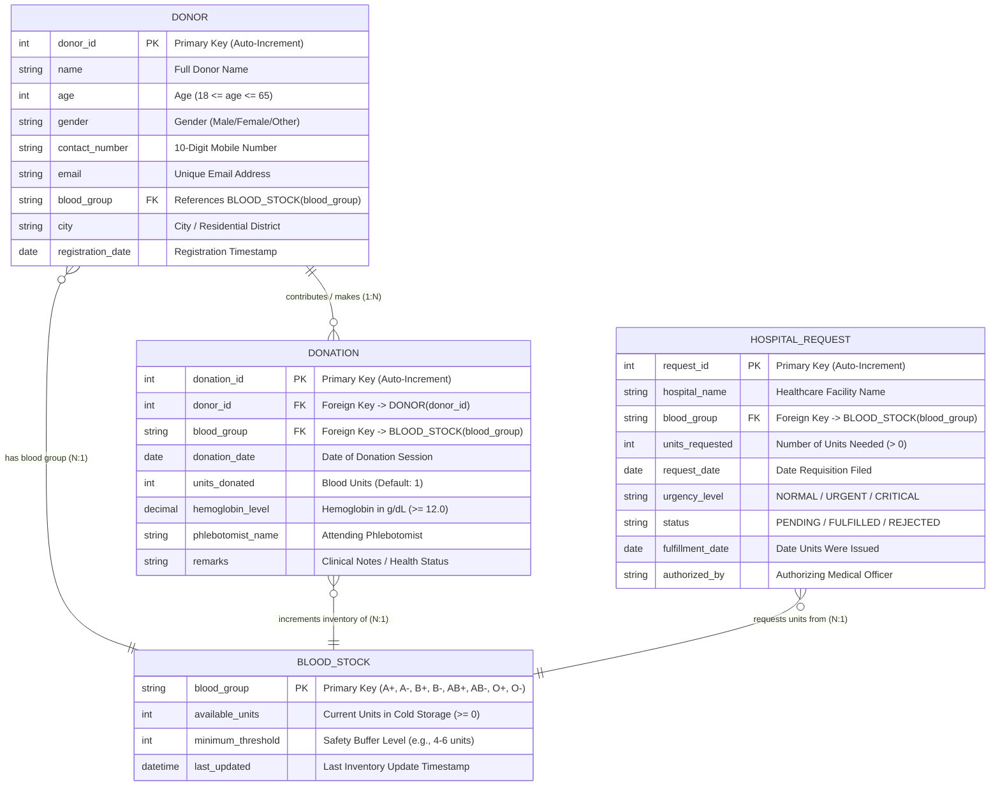

# Entity-Relationship (ER) Diagram Specification
## Blood Donation Management and Donor Availability Analysis System
**Academic Year:** 2026 - 2027 (ODD Semester)  
**Course Code & Name:** 25ITT31 - Database Management Systems  
**Institution:** Velalar College of Engineering and Technology, Erode - 638012  
**Department:** Department of Information Technology  
**Student Name:** Karan Raajaa V  
**Register Number:** 732925ITR045  
**Class & Section:** 25IT3A (Roll No: 45)  
**Scenario:** Scenario 15 - Blood Donation Management and Donor Availability Analysis System  

---

## 1. Conceptual ER Diagram (Crow's Foot Notation)

The Entity-Relationship model conceptualizes the blood bank domain into four primary entity sets, their defining attributes, and the relational mappings that enforce medical donation safety, inventory tracking, and hospital requisition workflows.



---

## 2. Structural Schema & Cardinality Diagram (Text/Box Layout)

```
+-------------------------------------------------------------------------------------------------------+
|                                    STRUCTURAL ER ARCHITECTURE                                         |
+-------------------------------------------------------------------------------------------------------+

   +--------------------------+                                 +-----------------------------+
   |          DONOR           |                                 |          DONATION           |
   +--------------------------+                                 +-----------------------------+
   | * donor_id          (PK) | 1                             N | * donation_id          (PK) |
   |   name                   |<--------------------------------|   donor_id             (FK) |
   |   age                    |       [ MAKES / CONTRIBUTES ]   |   blood_group          (FK) |
   |   gender                 |                                 |   donation_date             |
   |   contact_number         |                                 |   units_donated             |
   |   email                  |                                 |   hemoglobin_level          |
   |   blood_group       (FK) |--+                              |   phlebotomist_name         |
   |   city                   |  |                              |   remarks                   |
   |   registration_date      |  |                              +-----------------------------+
   +--------------------------+  |                                             |
                                 |                                             | N
                                 | N                                           |
                                 |       +-----------------------------+       |
                                 |       |         BLOOD_STOCK         |       |
                                 +------>| * blood_group          (PK) |<------+ [ INCREMENTS ]
                                         |   available_units           |
                                         |   minimum_threshold         |
                                         |   last_updated              |
                                         +-----------------------------+
                                                        ^
                                                        | 1
                                                        |
                                                        | [ REQUESTS FROM ]
                                                        |
                                                        | N
                                         +-----------------------------+
                                         |      HOSPITAL_REQUEST       |
                                         +-----------------------------+
                                         | * request_id           (PK) |
                                         |   hospital_name             |
                                         |   blood_group          (FK) |
                                         |   units_requested           |
                                         |   request_date              |
                                         |   urgency_level             |
                                         |   status                    |
                                         |   fulfillment_date          |
                                         |   authorized_by             |
                                         +-----------------------------+
```

---

## 3. Data Dictionary & Entity Attributes Specification

### 3.1 Entity: `DONOR`
Stores demographic, contact, and biological details of voluntary blood donors.

| Attribute Name | Data Type | Key Type | Nullable? | Domain / Constraints | Description |
|---|---|---|:---:|---|---|
| `donor_id` | `INTEGER` | **PK** | No | Auto-Increment ($1, 2, 3 \dots$) | Unique identification number for every donor |
| `name` | `VARCHAR(100)` | - | No | $2 \le \text{length} \le 100$, Alphabetic | Full legal name of the voluntary donor |
| `age` | `INTEGER` | - | No | `CHECK (age BETWEEN 18 AND 65)` | Clinical age eligibility boundary |
| `gender` | `VARCHAR(10)` | - | No | `CHECK (gender IN ('Male','Female','Other'))` | Gender identity |
| `contact_number` | `VARCHAR(15)` | - | No | Regex: `^[6-9][0-9]{9}$` (10 Digits) | Primary telephone/mobile contact |
| `email` | `VARCHAR(100)` | **Unique** | Yes | Valid email format | Electronic mail for donation certificates/alerts |
| `blood_group` | `VARCHAR(5)` | **FK** | No | References `blood_stock(blood_group)` | Donor's ABO/Rh blood group |
| `city` | `VARCHAR(50)` | - | No | Residential municipality | Geographic location (Erode, Perundurai, etc.) |
| `registration_date` | `DATE` | - | No | Default: `CURRENT_DATE` | Date donor registered in the system |

---

### 3.2 Entity: `DONATION`
Records individual whole-blood donation events and tracks collected volumes.

| Attribute Name | Data Type | Key Type | Nullable? | Domain / Constraints | Description |
|---|---|---|:---:|---|---|
| `donation_id` | `INTEGER` | **PK** | No | Auto-Increment ($101, 102 \dots$) | Unique identifier for the donation session |
| `donor_id` | `INTEGER` | **FK** | No | References `donors(donor_id)` | Foreign key identifying the contributing donor |
| `blood_group` | `VARCHAR(5)` | **FK** | No | References `blood_stock(blood_group)` | Blood group collected during session |
| `donation_date` | `DATE` | - | No | ISO Date: `YYYY-MM-DD` | Date whole blood was drawn |
| `units_donated` | `INTEGER` | - | No | `CHECK (units_donated >= 1)`, Default: 1 | Number of units collected (1 unit $\approx 450$ mL) |
| `hemoglobin_level` | `DECIMAL(4,2)`| - | No | `CHECK (hemoglobin_level >= 12.0)` | Hemoglobin concentration in g/dL |
| `phlebotomist_name`| `VARCHAR(100)`| - | No | Default: `'Staff Duty Officer'` | Attending nurse/doctor who drew blood |
| `remarks` | `VARCHAR(255)`| - | Yes | Default: `'Fit for donation'` | Post-donation recovery and vitals status |

---

### 3.3 Entity: `BLOOD_STOCK`
Maintains real-time inventory counts categorized by ABO/Rh blood groups.

| Attribute Name | Data Type | Key Type | Nullable? | Domain / Constraints | Description |
|---|---|---|:---:|---|---|
| `blood_group` | `VARCHAR(5)` | **PK** | No | `{'A+','A-','B+','B-','AB+','AB-','O+','O-'}` | Primary key identifying the blood type |
| `available_units` | `INTEGER` | - | No | `CHECK (available_units >= 0)`, Default: 0 | Current number of sealed units in cold storage |
| `minimum_threshold`| `INTEGER` | - | No | `CHECK (minimum_threshold >= 0)`, Default: 5 | Buffer safety level before raising deficit alert |
| `last_updated` | `DATETIME` | - | No | Default: `CURRENT_TIMESTAMP` | Timestamp of the most recent stock update |

---

### 3.4 Entity: `HOSPITAL_REQUEST`
Tracks blood requisitions submitted by medical facilities and their fulfillment lifecycle.

| Attribute Name | Data Type | Key Type | Nullable? | Domain / Constraints | Description |
|---|---|---|:---:|---|---|
| `request_id` | `INTEGER` | **PK** | No | Auto-Increment ($201, 202 \dots$) | Unique requisition tracking number |
| `hospital_name` | `VARCHAR(120)`| - | No | Healthcare organization name | Destination hospital (e.g. Apollo, KMCH) |
| `blood_group` | `VARCHAR(5)` | **FK** | No | References `blood_stock(blood_group)` | Required ABO/Rh blood group |
| `units_requested` | `INTEGER` | - | No | `CHECK (units_requested > 0)` | Quantity of blood units requested |
| `request_date` | `DATE` | - | No | Default: `CURRENT_DATE` | Date request was received |
| `urgency_level` | `VARCHAR(10)` | - | No | `CHECK (urgency IN ('NORMAL','URGENT','CRITICAL'))` | Clinical priority level |
| `status` | `VARCHAR(15)` | - | No | `CHECK (status IN ('PENDING','FULFILLED','REJECTED'))` | Current lifecycle state |
| `fulfillment_date`| `DATE` | - | Yes | `NULL` until fulfilled | Date units were decremented and dispatched |
| `authorized_by` | `VARCHAR(100)`| - | Yes | Medical officer name | Duty officer approving the dispatch |

---

## 4. Relationship Types & Participation Constraints

| Relationship Name | Connected Entities | Cardinality Ratio | Participation: Entity 1 | Participation: Entity 2 | Business & Clinical Rule |
|---|---|:---:|:---:|:---:|---|
| **MAKES / CONTRIBUTES** | `DONOR` $\to$ `DONATION` | **$1 : N$** | **Partial** $(0..N)$ | **Total** $(1..1)$ | A donor may exist without having donated yet (first-time donor), but every donation record must belong to exactly one valid donor. |
| **ASSOCIATED_GROUP** | `DONOR` $\to$ `BLOOD_STOCK` | **$N : 1$** | **Total** $(1..1)$ | **Partial** $(0..N)$ | Every donor must have a valid blood group that exists in the master blood stock inventory. |
| **INCREMENTS_INVENTORY** | `DONATION` $\to$ `BLOOD_STOCK` | **$N : 1$** | **Total** $(1..1)$ | **Partial** $(0..N)$ | Each donation session directly adds units to the inventory of that specific blood group. |
| **REQUISITIONS_FROM** | `HOSPITAL_REQUEST` $\to$ `BLOOD_STOCK` | **$N : 1$** | **Total** $(1..1)$ | **Partial** $(0..N)$ | Every hospital request specifies a required blood group from the inventory; fulfillment decrements units atomically. |

---

## 5. Conceptual Chen Notation ER Diagram (Peter Chen Model)

> [!NOTE]
> **Visual Chen Notation Diagram Available**:
> - Interactive Web Viewer: [chen_er_diagram.html](file:///E:/Assingment_1/diagrams/chen_er_diagram.html)
> - Scalable Vector Graphic (SVG): [chen_er_diagram.svg](file:///E:/Assingment_1/diagrams/chen_er_diagram.svg)

In the classic **Peter Chen ER Model** (matching the traditional academic textbook style with rectangles for entities, diamonds for relationships, and ovals/ellipses for attributes):

```
                                  (Donor_ID) [PK]
                                     /
             (Name) ---- [ DONOR ] ---- (Age)
                         /   |   \
                   (Gender)  |  (Contact_No)
                             |
                         < Makes >  (1:N)
                             |
                                  (Donation_ID) [PK]
                                     /
        (Donation_Date) - [ DONATION ] - (Hemoglobin)
                          /     |    \
                (Units_Donated) |   (Phlebotomist)
                                |
                         < Increments >  (N:1)
                                |
                                  (Blood_Group) [PK]
                                     /
      (Available_Units) - [ BLOOD_STOCK ] - (Min_Threshold)
                                |    \
                                |   (Last_Updated)
                                |
                         < Supplies >  (1:N)
                                |
                                  (Request_ID) [PK]
                                     /
     (Hospital_Name) - [ HOSPITAL_REQUEST ] - (Urgency_Level)
                       /      |         \
              (Units_Req)  (Status)   (Fulfillment_Date)
```

### Chen Notation Component Mapping:
1. **Entity Sets (Rectangles):**
   - `DONOR`, `DONATION`, `BLOOD_STOCK`, `HOSPITAL_REQUEST`
2. **Relationships (Diamonds):**
   - `< Makes >` (1:N between `DONOR` and `DONATION`)
   - `< Increments >` (N:1 between `DONATION` and `BLOOD_STOCK`)
   - `< Supplies >` (1:N between `BLOOD_STOCK` and `HOSPITAL_REQUEST`)
   - `< Has Group >` (N:1 between `DONOR` and `BLOOD_STOCK`)
3. **Key Attributes (Underlined Text in Ellipses):**
   - `Donor_ID` (Key Attribute of `DONOR`)
   - `Donation_ID` (Key Attribute of `DONATION`)
   - `Blood_Group` (Key Attribute of `BLOOD_STOCK`)
   - `Request_ID` (Key Attribute of `HOSPITAL_REQUEST`)
4. **Regular Attributes (Ellipses):**
   - `DONOR`: `Name`, `Age`, `Gender`, `Contact_Number`, `Email`, `City`, `Reg_Date`
   - `DONATION`: `Donation_Date`, `Units_Donated`, `Hemoglobin_Level`, `Phlebotomist_Name`, `Remarks`
   - `BLOOD_STOCK`: `Available_Units`, `Minimum_Threshold`, `Last_Updated`
   - `HOSPITAL_REQUEST`: `Hospital_Name`, `Units_Requested`, `Request_Date`, `Urgency_Level`, `Status`, `Fulfillment_Date`, `Authorized_By`
5. **Derived Attributes (Dashed Ellipses):**
   - `days_since_last_donation = CURRENT_DATE - MAX(donation_date)`
   - `eligibility_status = IF(days_since >= 90, 'ELIGIBLE', 'INELIGIBLE')`
   - `surplus_deficit = available_units - minimum_threshold`
   - *(Implemented in the database via SQL Views `v_donor_availability` and `v_stock_summary`)*

---

## 6. Relational Mapping & Integrity Rules

The conceptual ER model maps to a normalized relational schema satisfying **Boyce-Codd Normal Form (BCNF)**:

1. **Foreign Key Referential Integrity:**
   - Deleting a donor automatically cascades to remove their historical donation logs:  
     `FOREIGN KEY (donor_id) REFERENCES donors(donor_id) ON DELETE CASCADE`
   - Updating a blood group code cascades across all referencing child tables:  
     `ON UPDATE CASCADE`
2. **Check Constraints:**
   - Non-negative inventory: `CHECK (available_units >= 0)`
   - Medical donor age: `CHECK (age >= 18 AND age <= 65)`
   - Safe hemoglobin level: `CHECK (hemoglobin_level >= 12.0)`
3. **Clinical 90-Day Cooldown Verification:**
   - Enforced by `DonorEligibilityService` and SQL View `v_donor_availability` by checking:
     $$\Delta t = \text{JULIANDAY}(\text{CURRENT\_DATE}) - \text{JULIANDAY}(\max(\text{donation\_date})) \ge 90$$

---
*Prepared and verified for academic submission by Karan Raajaa V (Reg. No: 732925ITR045, Class: 25IT3A).*
