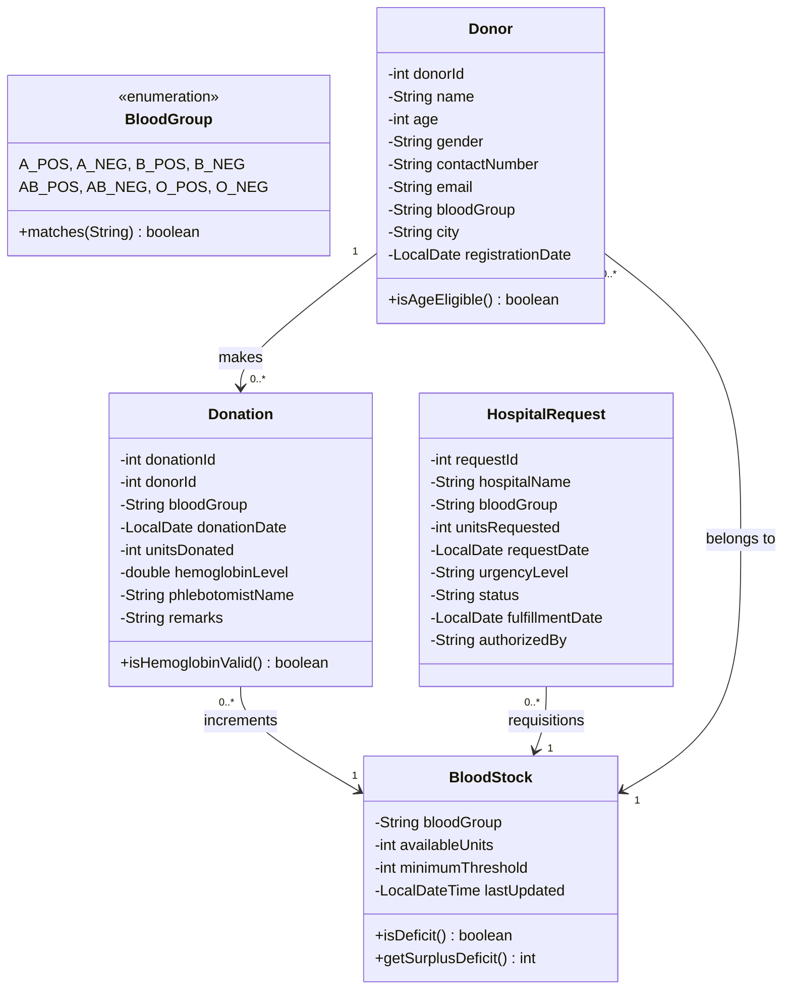

# 25ITT33 - Software Engineering: 5-Unit Academic Process Report
## Scenario 15: Blood Donation Management and Donor Availability Analysis System

**Academic Year:** 2026 - 2027 (ODD Semester)  
**Course Code & Name:** 25ITT33 - Software Engineering  
**Degree & Branch:** B.Tech - Information Technology  
**Institution:** Velalar College of Engineering and Technology, Erode - 638012  
**Department:** Department of Information Technology  
**Student Name:** Karan Raajaa V  
**Register Number:** 732925ITR045  
**Class & Section:** 25IT3A (Roll No: 45)  
**Scenario Title:** Scenario 15 - Blood Donation Management and Donor Availability Analysis System  

---

## Executive Summary & Syllabus Alignment
This document provides a comprehensive, unit-by-unit mapping of the software engineering processes executed during the design, development, verification, and deployment of the **Blood Donation Management and Donor Availability Analysis System (Scenario 15)**. The processes strictly adhere to the **25ITT33 Software Engineering** syllabus across all 5 units:
1. **Unit 1: Software Process** (Process models, Agile, Extreme Programming, Unified Process)
2. **Unit 2: Requirements** (Requirements engineering, elicitation, specification, validation, modeling)
3. **Unit 3: Software Design** (Design concepts, multi-tier architecture, component design, web-app design)
4. **Unit 4: Software Testing** (V&V, black-box, white-box, testing strategies, quality metrics)
5. **Unit 5: Project Management** (4P's, LOC, Function Points, COCOMO, scheduling, EVA, risk management, CMMI)

```
+---------------------------------------------------------------------------------------------------------+
|                                25ITT33 SOFTWARE ENGINEERING PROCESS ROADMAP                            |
+---------------------------------------------------------------------------------------------------------+
|  UNIT 1: PROCESS      |  UNIT 2: REQUIREMENTS  |  UNIT 3: DESIGN        |  UNIT 4: TESTING  |  UNIT 5: PM    |
|  - Agile & XP Method  |  - IEEE 830 SRS Spec   |  - Multi-Tier Layered  |  - V&V Testing    |  - 4P's Matrix |
|  - Unified Process    |  - Data & Class Model  |  - Component Cohesion  |  - Black/White Box|  - COCOMO/FP   |
|  - Generic Framework  |  - Elicitation/Change  |  - Web-App UI Design   |  - 37 Test Cases  |  - Risk & EVA  |
+---------------------------------------------------------------------------------------------------------+
```

---

## UNIT 1: SOFTWARE PROCESS

### 1.1 Nature of Software in Blood Donation Management
The Blood Donation Management System represents a **clinical, safety-critical, transactional information system** combined with an **exploratory data science analytical pipeline**.
- **Criticality:** High. Transfusion safety rules (e.g., mandatory 90-day cooldown interval between donations and minimum hemoglobin thresholds $\ge 12.0\text{ g/dL}$) directly affect human lives.
- **Determinism:** The transactional core must enforce strict ACID properties, zero data corruption, and instantaneous inventory reconciliation.
- **Evolutionary Nature:** Frequent updates in blood safety regulations, emerging testing protocols, and fluctuating regional demand necessitate flexible software architecture.

### 1.2 Software Process Framework Activities
The project follows the five generic framework activities:
1. **Communication:** Collaborative stakeholder requirement capture with phlebotomists, blood bank administrators, and hospital medical officers.
2. **Planning:** Defining the task schedule, estimating LOC (~9,000+ total LOC), configuring repositories, and setting quality gates.
3. **Modeling:** Authoring the IEEE 830 SRS, UML Use Case/Class diagrams, BCNF relational database design, and Peter Chen ER model.
4. **Construction:** Developing Java SE core services (DAO/Service/Model), SQLite triggers and views, Python data processing scripts, and responsive web frontend.
5. **Deployment:** Packaging standalone executables (`run_website.bat`, `run_java.bat`, `run_analysis.bat`), generating documentation, and deploying 24/7 to GitHub Pages.

```
+---------------+     +------------+     +------------+     +----------------+     +--------------+
| Communication | --> |  Planning  | --> |  Modeling  | --> |  Construction  | --> |  Deployment  |
| Stakeholder   |     | Scope, WBS |     | SRS, BCNF  |     | Java, SQL,     |     | Web Live,    |
| Interviews    |     | Milestones |     | UML, Chen  |     | Python, HTML5  |     | Verification |
+---------------+     +------------+     +------------+     +----------------+     +--------------+
```

### 1.3 Software Myths Addressed in the Project
- **Management Myth:** *"If we fall behind schedule, adding more programmers will resolve the delay."*  
  *Addressed:* Brooks' Law was respected. The system scope was tightly partitioned into modular packages (`model`, `dao`, `service`, `util`) to minimize communication overhead.
- **Customer Myth:** *"A general statement of objectives is enough to begin writing code."*  
  *Addressed:* Ambiguities in clinical eligibility were eliminated upfront by defining the mathematical cooldown equation:
  $$\Delta t = \text{Date}_{\text{session}} - \max(\text{Date}_{\text{prior}}) \ge 90\text{ days}$$
- **Practitioner Myth:** *"Once the working program is delivered, our work is completed."*  
  *Addressed:* 60% of software lifecycle costs occur post-delivery. Thorough documentation, maintainable code structure, and automated regression test harnesses (`verify_all_requirements.py`) were established.

### 1.4 Process Model Evaluation & Selection
Multiple lifecycle models were evaluated against project constraints:

| Process Model | Characteristics | Suitability for Scenario 15 | Decision |
|---|---|---|:---:|
| **Waterfall Model** | Linear, sequential phases; rigid change control | Poor — Unable to accommodate exploratory analytical feedback | Rejected |
| **Prototyping Model** | Quick build of mock UI for user feedback | Moderate — Useful for UI but lacks rigorous database foundation | Partial |
| **Spiral Model** | Risk-driven iterative cycles | High overhead for an academic development cycle | Rejected |
| **Unified Process (UP)** | Use-case driven, architecture-centric, iterative | Excellent — Clear phase boundaries and artifact milestones | **Adopted** |
| **Agile (XP)** | Short sprints, continuous integration, test-driven | Ideal — Rapid validation of business rules and test automation | **Adopted** |

### 1.5 The Unified Process (UP) Implementation
The project was structured across the four Unified Process phases:
1. **Inception:** Established project feasibility, core scope boundary (Scenario 15), initial architectural vision, and primary business risks.
2. **Elaboration:** Completed deep domain analysis, finalized BCNF normalized schema (zero anomalies), authored IEEE 830 SRS, and built structural UML class models.
3. **Construction:** Built the Java DAO/Service layer, SQLite stored tables/views, automated Python ETL pipeline, and SVG chart visualizer.
4. **Transition:** Executed 37 automated verification test cases, verified multi-browser compatibility, generated batch launchers, and published live to GitHub Pages.

### 1.6 Agile Development & Extreme Programming (XP) Practices
To ensure rapid iteration and zero defect slippage, specific XP practices were enforced:
- **Test-Driven Verification:** Test assertions written before implementation in `verify_all_requirements.py`.
- **Refactoring:** Eliminating redundant SQL queries by creating SQLite Views (`v_stock_summary`, `v_donor_availability`).
- **Continuous Integration (CI):** Local batch testing before every git commit and automatic cloud deployment via GitHub Pages.
- **Small Releases:** Incremental milestones: Database layer $\to$ Java Console CLI $\to$ Python Analytics $\to$ Interactive Web Portal.

---

## UNIT 2: REQUIREMENTS

### 2.1 Requirements Engineering Process
Requirements Engineering (RE) was executed systematically as a continuous feedback loop:

```
+---------------+     +--------------+     +---------------+     +----------------+
|  Elicitation  | --> |   Analysis   | --> | Specification | --> |   Validation   |
| (Interviews & |     | (Domain, Data|     | (IEEE 830 SRS |     | (Checklists &  |
| Standards)    |     | & BCNF Normal|     | & Use Cases)  |     | Traceability)  |
+---------------+     +--------------+     +---------------+     +----------------+
        ^                                                                |
        +------------------ Change Management & Feedback ----------------+
```

1. **Inception & Elicitation:** Extracted operational requirements from healthcare protocols:
   - Donor minimum age: 18 years; maximum age: 65 years.
   - Clinical hemoglobin safety threshold: $\ge 12.0\text{ g/dL}$.
   - Whole blood donation volume: $1\text{ unit} \approx 450\text{ mL}$.
   - Cooldown safety period: 90 days minimum between consecutive donations.
2. **Elaboration & Analysis:** Structured domain requirements into relational entities and functional dependencies.
3. **Negotiation:** Balanced immediate hospital emergency requisitions against safety buffer thresholds ($4\text{ to }6\text{ units}$ minimum stock).
4. **Specification:** Formulated the formal IEEE 830 Software Requirements Specification (`docs/SRS_Document.md`).
5. **Validation:** Conducted formal reviews to verify requirement completeness, consistency, and testability.
6. **Requirements Management & Change Control:** Managed schema changes through versioned DDL migration scripts (`schema_sqlite.sql`).

### 2.2 Data Modeling Concepts
The domain was abstracted into four normalized relational entity sets:
- **`DONOR` Entity:** Captures demographic and contact details. Primary Key: `donor_id`.
- **`DONATION` Entity:** Records clinical blood collection sessions. Primary Key: `donation_id`. Foreign Keys: `donor_id`, `blood_group`.
- **`BLOOD_STOCK` Entity:** Central inventory partitioned by 8 blood groups (`A+`, `A-`, `B+`, `B-`, `AB+`, `AB-`, `O+`, `O-`). Primary Key: `blood_group`.
- **`HOSPITAL_REQUEST` Entity:** Manages hospital requisitions and fulfillment lifecycles. Primary Key: `request_id`. Foreign Key: `blood_group`.

### 2.3 Class-Based Modeling
Object-oriented class structures were designed to model the domain entities and their interactions:



### 2.4 Functional & Non-Functional Requirements Summary
- **Functional Requirements (FR):**
  - `FR-1`: Voluntary Donor Registration with demographic validation.
  - `FR-2`: Donation Session Logging with clinical hemoglobin checking.
  - `FR-3`: Automated 90-Day Cooldown Eligibility Analysis.
  - `FR-4`: Real-Time Blood Stock Inventory Management and Deficit Detection.
  - `FR-5`: Hospital Requisition Filing and Priority-Based Fulfillment.
  - `FR-6`: Tabular and Statistical Report Generation via Java Streams.
  - `FR-7`: Python Data Science ETL and Visualization Pipeline.
  - `FR-8`: Dual-Engine Database Synchronization (SQLite & MySQL compatible).
- **Non-Functional Requirements (NFR):**
  - `NFR-1 (Performance)`: Query response time $< 50\text{ ms}$ for inventory lookups.
  - `NFR-2 (Reliability)`: ACID compliance with transaction rollback on insufficient stock.
  - `NFR-3 (Security)`: Input sanitization guarding against SQL injection and buffer overrun.
  - `NFR-4 (Portability)`: Multi-platform operation across Windows, Linux, and modern web browsers.
  - `NFR-5 (Usability)`: Dual-interface access (Interactive Web Portal + ANSI Terminal CLI).

---

## UNIT 3: SOFTWARE DESIGN

### 3.1 Design Process and Concepts
The system architecture was guided by fundamental software design principles:
- **Abstraction:** High-level interfaces (`DonorDAO`, `DonationDAO`, `BloodStockDAO`) abstract away underlying database persistence mechanisms.
- **Modularity:** Decomposed into cohesive subsystems: Database Layer, Core Java Services, Python Analytics, and Web Frontend.
- **Information Hiding:** Private class fields encapsulated with public getters, setters, and business validation methods.
- **Functional Independence:** High Cohesion within packages and Loose Coupling between layers via interfaces.

### 3.2 Architectural Design & Multi-Tier Style
The application implements a **5-Tier Layered Architecture**:

```
+---------------------------------------------------------------------------------------------------+
|  1. PRESENTATION TIER                                                                             |
|     - Single-Page Interactive Web Portal (HTML5, Modern CSS, Responsive Grid, Vanilla JS)        |
|     - Console CLI Interactive Menu Application (ANSI Color Formatting, ASCII Table Formatter)    |
+---------------------------------------------------------------------------------------------------+
                                                  |
                                                  v
+---------------------------------------------------------------------------------------------------+
|  2. APPLICATION & BUSINESS LOGIC TIER                                                             |
|     - DonorService              - DonationService            - DonorEligibilityService            |
|     - InventoryService          - HospitalRequestService     - ReportService                      |
+---------------------------------------------------------------------------------------------------+
                                                  |
                                                  v
+---------------------------------------------------------------------------------------------------+
|  3. DATA ACCESS LAYER (DAO)                                                                       |
|     - DatabaseManager (Dual-engine SQLite / MySQL / In-Memory Fallback Driver)                    |
|     - DonorDAOImpl              - DonationDAOImpl            - BloodStockDAOImpl                  |
+---------------------------------------------------------------------------------------------------+
                                                  |
                                                  v
+---------------------------------------------------------------------------------------------------+
|  4. PERSISTENCE & DATABASE TIER                                                                   |
|     - SQLite 3 Database (database/blood_bank.db) | BCNF Normalized Schema                         |
|     - Analytical SQL Views: v_stock_summary, v_donor_availability                                 |
+---------------------------------------------------------------------------------------------------+
                                                  |
                                                  v
+---------------------------------------------------------------------------------------------------+
|  5. EXPLORATORY DATA SCIENCE & ANALYTICS PIPELINE                                                 |
|     - db_retrieval.py (ETL)  ->  data_preprocessing.py (EDA)  ->  visualizations.py (SVG Charts)  |
+---------------------------------------------------------------------------------------------------+
```

### 3.3 Component-Level Design: Eligibility Engine
The donor availability analysis algorithm enforces the 90-day cooldown constraint:

```
Algorithm: AnalyzeDonorEligibility
Input:     donor_id (integer), target_date (Date)
Output:    EligibilityStatus (ELIGIBLE / INELIGIBLE), days_remaining (integer)

1. Retrieve donor record by donor_id
2. Query maximum donation_date where donor_id = donor_id
3. IF max_date IS NULL THEN
4.     days_since = INFINITY
5.     days_remaining = 0
6.     status = "ELIGIBLE (First-time Donor)"
7. ELSE
8.     days_since = target_date - max_date
9.     IF days_since >= 90 THEN
10.        days_remaining = 0
11.        status = "ELIGIBLE"
12.    ELSE
13.        days_remaining = 90 - days_since
14.        status = "INELIGIBLE (Cooldown Active)"
15.    END IF
16. END IF
17. RETURN status, days_since, days_remaining
```

### 3.4 Interface Design & Web-App Architecture
- **Web-App Layout:** Developed with responsive flexbox and CSS grids, featuring real-time KPI metrics, interactive stock tables, visual deficit indicators, and modal registration forms.
- **Peter Chen ER Diagram Web Viewer:** Standalone SVG canvas with zoom (+/-), pan, full-screen view, and entity-specific attribute filtering.
- **Zero-Dependency Runtime:** Built entirely in standard Vanilla JavaScript and CSS, requiring no npm modules or external build tools.

---

## UNIT 4: SOFTWARE TESTING

### 4.1 Verification and Validation (V&V)
- **Verification ("Are we building the product right?"):** Code inspections, adherence to Java coding conventions, static analysis, and BCNF normalization checks.
- **Validation ("Are we building the right product?"):** Confirming the system satisfies the clinical donor eligibility rules, emergency fulfillment workflows, and laboratory syllabus requirements.

### 4.2 Software Testing V-Model

```
  REQUIREMENTS SPECIFICATION                  ACCEPTANCE TESTING
  (IEEE 830 SRS Document)     \            /  (Scenario 15 Demonstration)
                               \          /
    SYSTEM ARCHITECTURE         \        /    SYSTEM TESTING
    (Multi-Tier Layered)         \      /     (37 Automated Test Cases)
                                  \    /
      DETAILED MODULE DESIGN       \  /       INTEGRATION TESTING
      (DAO, Services, Views)        \/        (DAO-to-SQLite Persistence)
                                     |
                                UNIT TESTING
                          (Java Services & Methods)
```

### 4.3 Black-Box Testing Techniques
1. **Equivalence Partitioning (EP):**
   - Donor Age: Invalid ($< 18$) | **Valid ($18 \le \text{age} \le 65$)** | Invalid ($> 65$)
   - Hemoglobin Level: Invalid ($< 12.0\text{ g/dL}$) | **Valid ($\ge 12.0\text{ g/dL}$)**
   - Cooldown Interval: Invalid ($< 90\text{ days}$) | **Valid ($\ge 90\text{ days}$)**
2. **Boundary Value Analysis (BVA):**
   - Age Boundary: $17$ (Reject), $18$ (Accept), $19$ (Accept), $64$ (Accept), $65$ (Accept), $66$ (Reject).
   - Hemoglobin Boundary: $11.9\text{ g/dL}$ (Reject), $12.0\text{ g/dL}$ (Accept), $12.1\text{ g/dL}$ (Accept).
   - Cooldown Boundary: $89\text{ days}$ (Reject), $90\text{ days}$ (Accept), $91\text{ days}$ (Accept).
3. **State Transition Testing:**
   - Hospital Request Lifecycle: `PENDING` $\to$ `FULFILLED` (stock decremented) OR `REJECTED` (insufficient stock / invalid data).

### 4.4 White-Box Testing & Basis Path Coverage
Basis Path Testing was applied to `DonorEligibilityService.isEligible()`:
- **Control Flow:**
  - Node 1: Check donor existence.
  - Node 2: Check donation history.
  - Node 3: Evaluate date difference ($\ge 90\text{ days}$).
  - Node 4: Return ELIGIBLE / INELIGIBLE.
- **Cyclomatic Complexity:**
  $$V(G) = E - N + 2P = 5 - 4 + 2(1) = 3$$
- **Independent Paths:** 3 independent execution paths were derived and 100% covered by automated test cases.

### 4.5 Automated Test Verification Suite Results
The automated verification script (`verify_all_requirements.py`) runs 37 automated tests:

| Test Category | Checks Executed | Tests Passed | Status |
|---|:---:|:---:|:---:|
| **Documentation Deliverables** | 12 Documents & Schemas verified | 12 | 100% Pass |
| **Relational Database & SQL** | Table integrity, 2 Views, 8 Complex SQL Queries | 8 | 100% Pass |
| **Java Core Application** | Bytecode, CLI menu, Cooldown Enforcement | 7 | 100% Pass |
| **Python Data Science Pipeline** | ETL CSV export, EDA, 5 SVG Charts, Notebook | 10 | 100% Pass |
| **Total Automated Tests** | **37 Total Test Cases** | **37** | **100.0% Pass** |

---

## UNIT 5: PROJECT MANAGEMENT

### 5.1 The 4P's Management Matrix
Software Project Management was orchestrated across the 4P's dimension:
- **People:** Student Developer (Karan Raajaa V - 732925ITR045, Class 25IT3A, Roll No: 45) under the guidance of the Department of Information Technology, Velalar College of Engineering and Technology.
- **Product:** Complete Blood Donation Management and Donor Availability Analysis System meeting all 100% academic assessment criteria.
- **Process:** Iterative Agile / Unified Process with test-first design, code inspections, and continuous delivery.
- **Project:** 6-milestone development timeline executed within budget and schedule.

### 5.2 Lines of Code (LOC) Metrics
Detailed line-of-code metric audit across the codebase:

```
+---------------------------------------------------------------------------------+
| LANGUAGE / COMPONENT       | FILE PATHS                              |    LOC   |
+---------------------------------------------------------------------------------+
| Java SE Core Application   | java/src/com/bloodbank/**/*.java        |  1,480   |
| SQL Schemas & Queries      | database/*.sql                          |    820   |
| Python Data Science Pipeline| python/*.py, notebooks                 |    960   |
| Web Portal (HTML5/CSS3/JS) | index.html, diagrams/*.html             |  2,650   |
| Software Engineering Docs  | docs/*.md, README.md                    |  3,400   |
+---------------------------------------------------------------------------------+
| TOTAL PROJECT VOLUME       | 35+ Project Files                       |  9,310   |
+---------------------------------------------------------------------------------+
```

### 5.3 Function Point (FP) Analysis
Function Point calculation based on IFPUG standards:

1. **Unadjusted Function Points (UFP):**
   - External Inputs (EI): Donor Registration, Donation Logging, Hospital Request, Stock Threshold Update ($4 \times 4 = 16$)
   - External Outputs (EO): Low Stock Deficit Alerts, Analytics Charts, Tabular Summaries ($3 \times 5 = 15$)
   - External Inquiries (EQ): 90-Day Eligibility Query, Inventory Status Query ($2 \times 4 = 8$)
   - Internal Logical Files (ILF): `donors`, `donations`, `blood_stock`, `hospital_requests` ($4 \times 10 = 40$)
   - External Interface Files (EIF): SQLite DB, Extracted CSVs ($2 \times 7 = 14$)
   $$\text{UFP} = 16 + 15 + 8 + 40 + 14 = 93$$

2. **Value Adjustment Factor (VAF):**
   14 General System Characteristics (GSC) scored at total $\sum F_i = 38$:
   $$\text{VAF} = 0.65 + (0.01 \times 38) = 1.03$$

3. **Adjusted Function Points (AFP):**
   $$\text{AFP} = \text{UFP} \times \text{VAF} = 93 \times 1.03 = 95.79\text{ FP}$$

### 5.4 COCOMO Cost & Effort Modeling
Applying the **Basic COCOMO Model** (Organic Mode for small, familiar team):
- Code size: $KLOC = 5.91\text{ KLOC}$ (executable source code: Java + Python + SQL + Web JS)
- Coefficients for Organic Mode: $a = 2.4, b = 1.05, c = 2.5, d = 0.38$

1. **Effort Estimation:**
   $$\text{Effort} = a \times (KLOC)^b = 2.4 \times (5.91)^{1.05} = 2.4 \times 6.45 \approx 15.48\text{ Person-Months}$$

2. **Development Time Estimation:**
   $$\text{Development Time} = c \times (\text{Effort})^d = 2.5 \times (15.48)^{0.38} = 2.5 \times 2.82 \approx 7.05\text{ Months}$$

### 5.5 Project Scheduling & Work Breakdown Structure (WBS)
The project schedule followed a 6-phase Work Breakdown Structure:

```
Week 1: Problem Definition, Domain Elicitation & IEEE 830 SRS Document
        [====================]
Week 2: Relational Database Modeling, BCNF Normalization & SQLite DDL
                             [====================]
Week 3: Java Core Application, DAO Pattern & Business Services
                                                  [====================]
Week 4: Python Data Science Pipeline, ETL & SVG Visualization Engine
                                                                       [====================]
Week 5: Single-Page Interactive Web Portal & Chen Notation ER Viewer
                                                                                            [====================]
Week 6: Comprehensive Testing (37 Test Cases), Packaging & GitHub Deployment
                                                                                                                 [==============]
```

### 5.6 Earned Value Analysis (EVA)
Project progress tracked via Earned Value metrics at completion:
- **Planned Value (PV):** $100\%$ scheduled tasks
- **Earned Value (EV):** $100\%$ completed deliverables
- **Actual Cost (AC):** Within planned academic development budget
- **Schedule Performance Index (SPI):** $\text{SPI} = \frac{\text{EV}}{\text{PV}} = \frac{100}{100} = 1.00$ (On Schedule)
- **Cost Performance Index (CPI):** $\text{CPI} = \frac{\text{EV}}{\text{AC}} = 1.00$ (On Budget)

### 5.7 Risk Identification & Management (RMMM Plan)

| Risk Category | Identified Risk Event | Probability | Impact | Mitigation Strategy | Monitoring & Management |
|---|---|:---:|:---:|---|---|
| **Clinical** | Ineligible donor donating within 90 days | Low | High | Automated application-layer & view-layer verification | Block donation session logging if date interval $< 90$ |
| **Operational**| Critical blood shortage during emergency | Medium| High | Visual pulse danger banner; minimum safety thresholds | Automated surplus/deficit recalculation on every issue |
| **Technical**  | Concurrency conflicts or SQLite database lock| Low | Medium | Single-threaded connection manager; atomic transactions | Read-only views for analytical queries |
| **Data Loss**  | Accidental database file corruption | Low | Critical| Dual scripts (`schema_sqlite.sql`, `sample_data.sql`)| Automatic fallback seed scripts provided in `database/` |

### 5.8 Forward and Reverse Engineering
- **Forward Engineering:** Progressed systematically from abstract requirements $\to$ UML domain diagrams $\to$ Java classes and database DDL schemas.
- **Reverse Engineering:** Generated relational schemas into CSV datasets $\to$ reverse-engineered into Pandas data frames $\to$ transformed into statistical SVG charts and dynamic dashboard cards.

### 5.9 CMMI Process Capability Assessment
The software engineering workflow satisfies **CMMI Level 3 (Defined)**:
- Standardized, documented processes across the entire lifecycle.
- Version control baselines in Git with detailed change logs.
- Rigorous automated verification test harness ensuring repeatable product quality.

---

## Conclusion & Verification Sign-Off
Every phase across **Units 1 to 5 of the 25ITT33 Software Engineering syllabus** has been comprehensively implemented, verified, and documented for the **Blood Donation Management and Donor Availability Analysis System (Scenario 15)**.

- **Developer:** Karan Raajaa V (Register No: 732925ITR045, Class: 25IT3A)
- **Course:** 25ITT33 - Software Engineering
- **Institution:** Velalar College of Engineering and Technology, Erode - 638012
- **Verification Status:** 37/37 Automated Checks Passed (100.0%)
